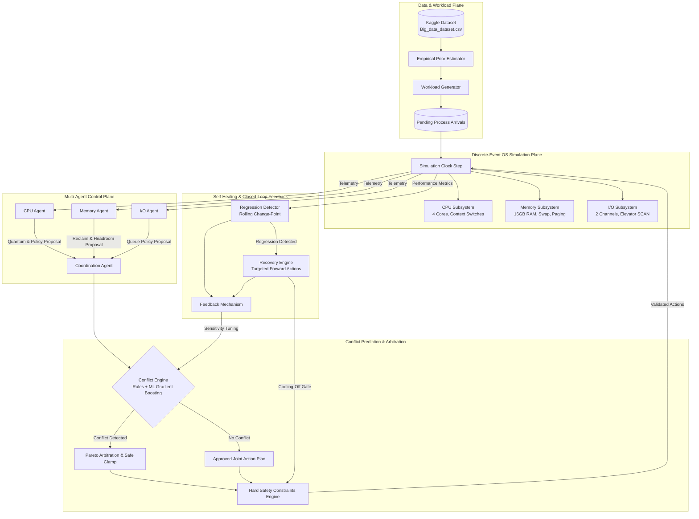

# CoReOS System Architecture

## 1. Overview and Core Design Principles
**CoReOS** (Conflict-Aware, Self-Healing Multi-Agent AI Operating System Resource Manager) is structured as a modular, discrete-event research platform. It coordinates multi-resource scheduling (CPU, Memory, I/O) through autonomous resource agents, pre-execution conflict prediction, and closed-loop self-healing recovery.

---

## 2. Module Responsibilities

### `src.coreos.data`
- **`loader.py`**: Resolves dataset location (`data/raw/Big_data_dataset.csv` with fallback to `data/Big_data_dataset.csv`), verifies file readability, checks for required headers, and handles malformed inputs.
- **`profiler.py`**: Computes empirical summary statistics, evaluates lag-1 autocorrelation to verify absence of continuous timestamps, and writes `reports/dataset_profile.md`.
- **`preprocessing.py`**: Extracts marginal distributions and correlations for simulator calibration; prepares train/test splits for supervised anomaly detection.

### `src.coreos.simulation`
- **`process.py`**: Encapsulates `SimulatedProcess` state transitions: `NEW -> READY -> RUNNING -> WAITING_IO -> TERMINATED`, maintaining waiting times, response times, page fault counts, and context switches.
- **`environment.py`**: Executes discrete time steps, manages core allocations, models page faults and swap thrashing, and handles disk seek elevator scheduling.
- **`workload.py`**: Generates reproducible process batches across 7 distinct workload profiles (`steady_state`, `cpu_spike`, `memory_thrashing`, `io_bottleneck`, `mixed`, `bursty`, `adversarial_stress`).
- **`metrics.py`**: Computes Jain's fairness index, mean and 95th-percentile turnaround times, throughput, and resource utilization.

### `src.coreos.agents`
- **`base.py`**: Defines `BaseResourceAgent` contract and `AgentAction` dataclass. Agents cannot directly modify simulator state.
- **`cpu_agent.py`**: Proposes dynamic time quantum (2.0 to 8.0 time units) based on ready queue depth and context switch overhead.
- **`memory_agent.py`**: Tracks physical RAM pressure and proposes headroom targets (0 to 4096 MB).
- **`io_agent.py`**: Selects disk arm scheduling (FCFS, SSTF, SCAN) and throttles low-priority background I/O under saturation.

### `src.coreos.coordination`
- **`constraints.py`**: Enforces non-negotiable hard bounds: quantum in $[1.0, 32.0]$, valid policy registrations, and memory reclamation within physical capacity.
- **`coordinator.py`**: Aggregates agent proposals, checks safety constraints, queries the conflict engine, applies Pareto adjustments, and falls back to deterministic baselines if model confidence drops below 0.40.

### `src.coreos.conflict_prediction`
- **`predictor.py`**: Fuses interpretable domain rules (`TRIPLE_CASCADE`, `THRASHING_CPU_COLLAPSE`, `IO_SWAP_SATURATION`) with a Gradient Boosting classifier to evaluate proposed action tuples against current resource state.
- **`conflict_log.py`**: Tracks predictions alongside ground-truth observed outcomes, computing Precision, Recall, F1, FPR, and FNR while preserving temporal causality.

### `src.coreos.self_healing`
- **`regression_detector.py`**: Monitors rolling throughput and turnaround statistics; triggers change-point regressions using 3-step patience to suppress transient noise. Thrashing stalls trigger immediate regression alerts.
- **`recovery.py`**: Executes targeted parameter overrides (quantum extension, emergency memory reclamation, elevator SCAN disk scheduling) with a 5-step cooling-off period to prevent oscillatory policy flapping. Includes `FeedbackMechanism` to tighten conflict prediction thresholds upon false negatives.

### `src.coreos.learning`
- **`environment.py`**: Provides Gymnasium-compatible discrete MDP interface (`CoReOSGymEnv`) with an 8D observation vector and 4 coordinated joint actions.
- **`train.py`**: Implements Q-Learning coordination with epsilon decay and JSON model checkpointing.

---

## 3. Data Flow and Failure Handling
1. **Pristine Workload Cloning**: In benchmark suites, all baselines run on cloned copies of the same process queue to guarantee identical initial conditions and arrival sequences.
2. **Hard Safety Gate**: Even if an RL agent or conflict predictor emits out-of-bounds parameters, `validate_safety_constraints()` clamps all values before they enter the simulation engine.
3. **Deterministic Fallbacks**: If the ML conflict model is unavailable or confidence is low, the coordinator falls back to proven conventional defaults (Round Robin with 4.0 quantum, SCAN I/O, 1024 MB headroom).
